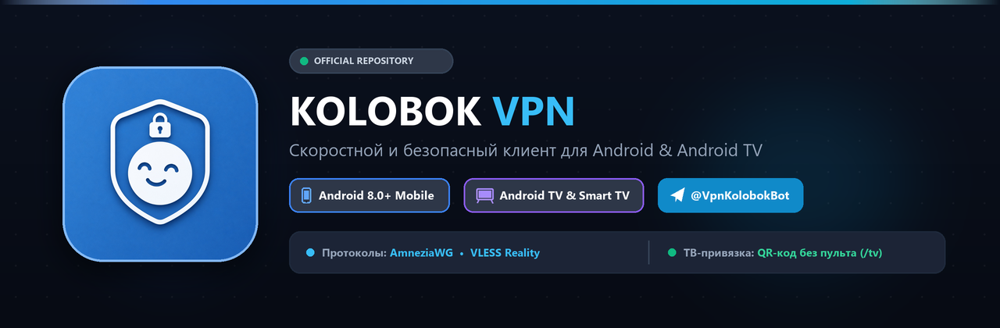

<p align="center">
  
</p>

<p align="center">
  <strong>Современный, скоростной и надёжный VPN-клиент для смартфонов, планшетов и Smart TV</strong>
</p>

<p align="center">
  <a href="https://github.com/Rik875/KolobokVPN/releases/latest">
    
  </a>
  <a href="https://t.me/VpnKolobokBot">
    
  </a>
  <a href="https://t.me/kolobokSupport">
    
  </a>
  
  
  
</p>

---

## 📥 Скачать приложение

Выберите подходящую версию для вашего устройства:

| Платформа | Версия | Файл | Размер | Ссылка на загрузку |
| :--- | :---: | :--- | :---: | :--- |
| 📱 **Android Mobile**<br>*(Смартфоны и планшеты)* | `v1.1` | `KolobokVPN_android_universal.apk` | ~64 МБ | [👉 **Скачать для Android**](https://github.com/Rik875/KolobokVPN/releases/latest/download/KolobokVPN_android_universal.apk) |
| 📺 **Android TV**<br>*(Телевизоры и ТВ-приставки)* | `v1.0` | `Kolobok_TV_release.apk` | ~64 МБ | [👉 **Скачать для Android TV**](https://github.com/Rik875/KolobokVPN/releases/latest/download/Kolobok_TV_release.apk) |

> 💡 *Все релизные файлы также доступны на странице [**GitHub Releases**](https://github.com/Rik875/KolobokVPN/releases).*

---

## ✨ Ключевые возможности

### ⚡ Высокоскоростные протоколы нового поколения
- **AmneziaWG 3.1**: Устойчивый к глубокому анализу пакетов (DPI) протокол с гибкой маскировкой заголовков.
- **VLESS Reality**: Продвинутая маскировка под обычный HTTPS-трафик (`flow: xtls-rprx-vision`, `pbk`, `sid`, `sni`, `fp: chrome`).
- Мгновенное подключение и минимальная нагрузка на батарею устройства.

### 📺 Умное подключение для Android TV без пульта
- Больше **никакого ручного ввода** длинных ссылок и ключей пультом на экране телевизора!
- Откройте приложение на ТВ, наведите камеру телефона на **QR-код** или отправьте команду `/tv КОД` боту [@VpnKolobokBot](https://t.me/VpnKolobokBot).
- Подписка и список серверов мгновенно передаются на телевизор через интернет.
- Полная адаптация интерфейса под управление пультом D-Pad.

### 🤖 Бесшовная интеграция с Telegram-ботом
- Получение ключей и управление подпиской в официальном боте [@VpnKolobokBot](https://t.me/VpnKolobokBot).
- **Автоматическое определение ключа**: скопируйте ссылку подписки `https://subkolobok.ftp.sh/...` или ключ `vless://` в Telegram, откройте приложение — оно само предложит импортировать сервер в 1 клик.
- Автоматическое чтение остатка трафика и срока действия подписки.

### 🛡️ Безопасность, приватность и Kill Switch
- Работа через официальный Android `VpnService` с аппаратным шифрованием.
- **Режим Kill Switch**: блокировка интернет-трафика при случайном обрыве VPN для предотвращения утечек реального IP-адреса.
- Защита от DNS-утечек (используются защищённые Cloudflare DNS `1.1.1.1` и Google `8.8.8.8`).
- Встроенный замер задержки (Ping Test) и умный авто-выбор самого быстрого сервера.

### 🔀 Раздельное туннелирование (Split Tunneling)
- **Исключение приложений (Черный список)**: направляйте банковские и госуслуги напрямую, минуя VPN.
- **Только выбранные (Белый список)**: направляйте через VPN только нужные приложения (браузеры, мессенджеры).
- Полная совместимость с обоими протоколами (AmneziaWG и VLESS Reality).

### 🚀 Комфорт, виджет и Material You
- **Виджет рабочего стола**: управление подключением в 1 клик с домашнего экрана телефона.
- **Плитка в шторке Android (Quick Tile)**: быстрое переключение VPN прямо из системной шторки уведомлений.
- **Мониторинг трафика и скорости**: живые счетчики скорости скачивания/отдачи и объем переданных данных за сессию.
- **Material You Dynamic Colors**: автоматическая адаптация палитры интерфейса под цвет ваших системных обоев (Android 12+) и выбор тем (Тёмная / Светлая).
- **Встроенное автообновление**: проверка и обновление приложения в один тап прямо из настроек.

---

## 📲 Инструкция по установке на Android (Смартфон / Планшет)

1. **Скачайте APK**: нажмите на [KolobokVPN_android_universal.apk](https://github.com/Rik875/KolobokVPN/releases/latest/download/KolobokVPN_android_universal.apk).
2. **Разрешите установку**: если Android покажет уведомление о загрузке из браузера, нажмите *«Все равно скачать»* и разрешите установку из этого источника.
3. **Установите и откройте** приложение **Kolobok VPN**.
4. **Получите ключ**:
   - Перейдите в Telegram-бота [@VpnKolobokBot](https://t.me/VpnKolobokBot).
   - Скопируйте вашу ссылку подписки или VLESS-ключ.
5. **Подключитесь**:
   - Вернитесь в приложение — оно автоматически предложит добавить найденный ключ.
   - Нажмите **«Подключить»** и подтвердите запрос Android на создание VPN-соединения.

---

## 📺 Инструкция по установке на Android TV / Smart TV

Подходит для любых телевизоров и приставок на базе **Android TV** и **Google TV** (Xiaomi Mi Box / TV Stick, Яндекс ТВ, Сбер Салют, Realme, TCL, Philips, Sony и др.).

### Способ 1: Через приложение «Downloader» (Самый быстрый способ)
1. На телевизоре откройте **Google Play Store** (или магазин приложений ТВ).
2. Найдите и установите бесплатное приложение **Downloader by AFTVnews**.
3. Запустите Downloader, в строке ввода URL укажите прямую ссылку на APK:
   ```text
   https://github.com/Rik875/KolobokVPN/releases/latest/download/Kolobok_TV_release.apk
   ```
4. Нажмите кнопку **Go** — файл скачается и телевизор предложит установить его.
5. При первом запуске разрешите Downloader установку неизвестных приложений в системных настройках ТВ.

---

### Способ 2: Через USB-флешку
1. Скачайте файл [Kolobok_TV_release.apk](https://github.com/Rik875/KolobokVPN/releases/latest/download/Kolobok_TV_release.apk) на компьютер и скопируйте его на обычную USB-флешку.
2. Вставьте флешку в USB-разъем телевизора или ТВ-приставки.
3. На телевизоре откройте любой файловый менеджер (например, встроенный проводник или бесплатный **X-plore File Manager** из магазина ТВ).
4. Найдите файл `Kolobok_TV_release.apk` на флешке, нажмите на него и подтвердите установку.

---

### Способ 3: Передача со смартфона через «Send Files to TV»
1. Установите приложение **Send Files to TV** из Google Play и на телефон, и на телевизор.
2. Скачайте `Kolobok_TV_release.apk` на телефон.
3. Откройте приложение на телефоне, нажмите **Send**, выберите скачанный APK и отправьте его на ТВ (оба устройства должны быть в одной сети Wi-Fi).
4. На телевизоре откройте полученный файл через любой файловый менеджер и установите.

---

## 🔗 Как подключить Android TV через Telegram-бота (без пульта)

1. Запустите приложение **Kolobok TV** на телевизоре.
2. Нажмите кнопку **«Привязать подписку / QR»**.
3. На экране появится QR-код и 4-значный код синхронизации:
   - **Вариант А**: Наведите камеру телефона на QR-код — откроется диалог с ботом, нажмите *«Запустить» (Start)*.
   - **Вариант Б**: Напишите в диалог с ботом [@VpnKolobokBot](https://t.me/VpnKolobokBot) команду:
     ```text
     /tv КОД_С_ЭКРАНА
     ```
4. В течение 2 секунд телевизор автоматически получит подписку и загрузит серверы.
5. Нажмите **«ПОДКЛЮЧИТЬ»** на пульте — приятного просмотра!

---

## ❓ Часто задаваемые вопросы (FAQ)

<details>
<summary><b>Android пишет: «Файл может быть вредоносным / небезопасным». Что делать?</b></summary>
<p>Это стандартное системное предупреждение Android при ручной установке любых APK-файлов, загруженных напрямую из интернета (вне Google Play). Файлы Kolobok VPN полностью безопасны, не содержат вредоносного кода или сторонней рекламы. Нажмите «Все равно скачать / Установить».</p>
</details>

<details>
<summary><b>Нужны ли Root-права для работы?</b></summary>
<p>Нет! Приложение использует стандартный официальный VpnService API Android и работает на любых немодифицированных устройствах без прав суперпользователя.</p>
</details>

<details>
<summary><b>Будет ли работать YouTube 4K, онлайн-кинотеатры и стриминги на телевизоре?</b></summary>
<p>Да. Серверы оптимизированы для высокой пропускной способности без буферизации даже в ультравысоком разрешении 4K 60fps.</p>
</details>

<details>
<summary><b>Где взять ключ доступа или продлить подписку?</b></summary>
<p>Все ключи и подписки генерируются и управляются в официальном Telegram-боте <a href="https://t.me/VpnKolobokBot">@VpnKolobokBot</a>.</p>
</details>

---

## 💬 Поддержка и сообщество

- 🤖 **Telegram-бот сервиса**: [@VpnKolobokBot](https://t.me/VpnKolobokBot)
- 🛟 **Служба технической поддержки**: [@kolobokSupport](https://t.me/kolobokSupport)
- 📢 **Новости и обновления**: следите за обновлениями в боте

---

<p align="center">
  <sub>Kolobok VPN © 2026. Сделано с душой для комфортного и свободного интернета.</sub>
</p>
