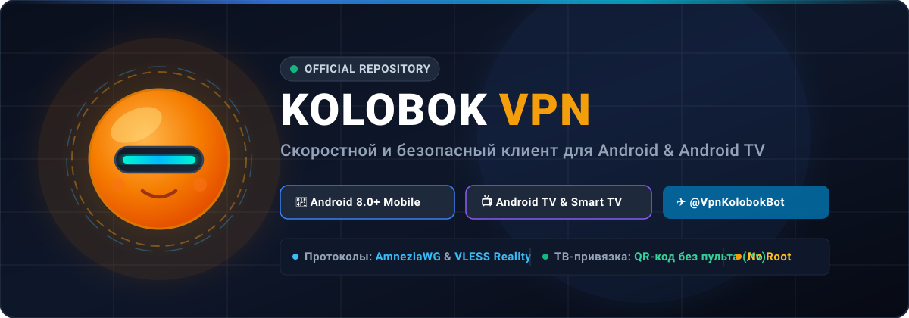

  

  <strong>Fast, censorship-resistant, and secure VPN client for Android smartphones, tablets, and Smart TV</strong>

  
  
  
  
  
  

  <a href="README.md">🇷🇺 Перейти на русскую версию</a>

---

## 📥 Download App

| Platform | Version | File | Size | Direct Link |
| :--- | :---: | :--- | :---: | :--- |
| 📱 **Android Mobile** *(Smartphones & Tablets)* | `v1.1` | `KolobokVPN_android_universal.apk` | ~64 MB | [👉 **Download for Android**](https://github.com/Rik875/kolobok-vpn/releases/latest/download/KolobokVPN_android_universal.apk) |
| 📺 **Android TV** *(Smart TVs & Streaming Boxes)* | `v1.0` | `Kolobok_TV_release.apk` | ~64 MB | [👉 **Download for Android TV**](https://github.com/Rik875/kolobok-vpn/releases/latest/download/Kolobok_TV_release.apk) |

> 💡 *All builds are available on the [**GitHub Releases**](https://github.com/Rik875/kolobok-vpn/releases) page.*

---

## ✨ Features

- **Advanced Anti-Censorship Protocols**: Native support for **AmneziaWG 3.1** and **VLESS Reality** (`xtls-rprx-vision`, `chrome` fingerprint, gRPC/xhttp).
- **Android TV Remote Sync (No Typing Required)**: Pair your Smart TV with a quick scan of a QR code via phone or Telegram command `/tv <code>`.
- **Telegram Bot Integration**: Fast key issuance and traffic monitoring via [@VpnKolobokBot](https://t.me/VpnKolobokBot).
- **1-Click Clipboard Import**: Auto-detects `vless://` and subscription links from clipboard upon app opening.
- **Leak-Proof TUN & DNS**: Custom DNS resolvers (Cloudflare `1.1.1.1` & Google `8.8.8.8`) and no-log routing.
- **Built-in Ping Latency Test**: Monitor server response time in real time.

---

## 📲 Installation Guide

### Android (Mobile & Tablets)
1. Download [KolobokVPN_android_universal.apk](https://github.com/Rik875/kolobok-vpn/releases/latest/download/KolobokVPN_android_universal.apk).
2. Enable "Install from unknown sources" if prompted.
3. Open the app, get your key from [@VpnKolobokBot](https://t.me/VpnKolobokBot), and press **Connect**.

### Android TV (Smart TVs, TV Boxes, Mi Box, Google TV)
1. **Via Downloader App (Recommended)**:
   - Install **Downloader by AFTVnews** from the TV app store.
   - Enter direct URL: `https://github.com/Rik875/kolobok-vpn/releases/latest/download/Kolobok_TV_release.apk`.
   - Download and install.
2. **Via USB Flash Drive**:
   - Copy `Kolobok_TV_release.apk` to a USB drive, plug it into the TV, and install using any TV file manager (e.g. X-plore).
3. **Pairing**:
   - Open Kolobok TV, click "Pair Subscription / QR", and scan the QR code with your smartphone or send `/tv <CODE>` to [@VpnKolobokBot](https://t.me/VpnKolobokBot).

---

## 💬 Support & Contact

- Telegram Bot: [@VpnKolobokBot](https://t.me/VpnKolobokBot)
- Customer Support: [@kolobokSupport](https://t.me/kolobokSupport)

---

  Kolobok VPN © 2026. Fast and private internet everywhere.

